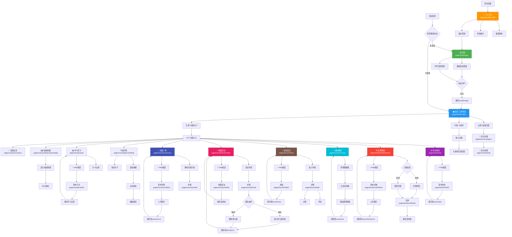
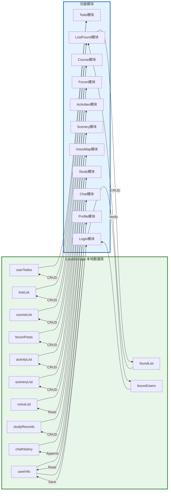
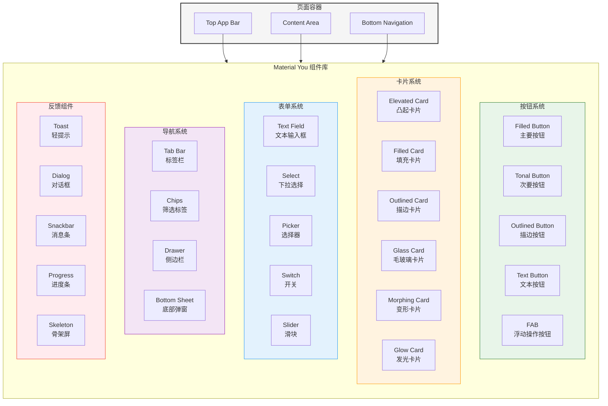
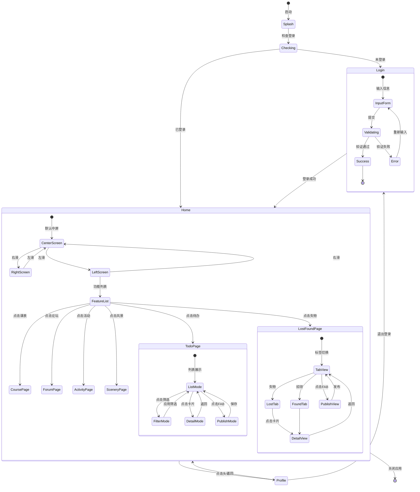
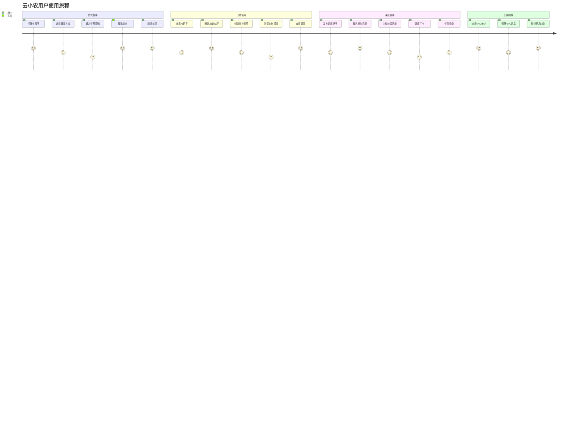

# 云小农智慧校园小程序 - 可视化界面关系图

## 📊 完整页面导航图 (Mermaid)



---

## 🔄 数据流向图



---

## 🎨 Material Design 3 组件层级图



---

## 📱 页面状态转换图



---

## 🎯 用户旅程地图 (User Journey Map)



---

## 📊 功能使用频率热力图

```
┌─────────────────────────────────────────────────────┐
│           功能模块使用频率预测                         │
├──────────────────┬──────────┬──────────┬────────────┤
│ 功能模块          │ 日活     │ 周活     │ 月活       │
├──────────────────┼──────────┼──────────┼────────────┤
│ AI助手           │ ⭐⭐⭐⭐⭐ │ ⭐⭐⭐⭐⭐ │ ⭐⭐⭐⭐⭐   │
│ 待办事项         │ ⭐⭐⭐⭐⭐ │ ⭐⭐⭐⭐⭐ │ ⭐⭐⭐⭐     │
│ 课程表           │ ⭐⭐⭐⭐   │ ⭐⭐⭐⭐⭐ │ ⭐⭐⭐⭐⭐   │
│ 失物招领         │ ⭐⭐⭐     │ ⭐⭐⭐⭐   │ ⭐⭐⭐⭐     │
│ 校园论坛         │ ⭐⭐⭐⭐   │ ⭐⭐⭐⭐⭐ │ ⭐⭐⭐⭐⭐   │
│ 校园活动         │ ⭐⭐⭐     │ ⭐⭐⭐⭐   │ ⭐⭐⭐⭐     │
│ 校园风景         │ ⭐⭐       │ ⭐⭐⭐     │ ⭐⭐⭐⭐     │
│ 留声机           │ ⭐⭐       │ ⭐⭐⭐     │ ⭐⭐⭐       │
│ 学习打卡         │ ⭐⭐⭐⭐   │ ⭐⭐⭐⭐⭐ │ ⭐⭐⭐⭐     │
│ 校园地图         │ ⭐⭐       │ ⭐⭐⭐     │ ⭐⭐⭐       │
└──────────────────┴──────────┴──────────┴────────────┘
```

---

## 🎨 UI设计规范速查表

### 色彩使用场景
```
Primary (#2E7D32):
  ✓ 主要按钮
  ✓ 激活状态
  ✓ 链接文字
  ✓ 图标高亮

Primary Container (#B8EFC1):
  ✓ 卡片背景
  ✓ 标签背景
  ✓ 悬浮按钮

Secondary (#52634F):
  ✓ 次要按钮
  ✓ 辅助信息

Tertiary (#D4A017):
  ✓ 强调元素
  ✓ 警告提示
  ✓ 特殊标记

Error (#BA1A1A):
  ✓ 错误提示
  ✓ 删除按钮
  ✓ 危险操作
```

### 间距规范
```
4rpx:  微小间距 (图标与文字)
8rpx:  小间距 (标签内边距)
12rpx: 中小间距 (相关元素间)
16rpx: 标准间距 (卡片内边距)
24rpx: 大间距 (区块间)
32rpx: 超大间距 (页面级)
```

### 字体大小
```
20rpx: 辅助文字 (标签说明)
22rpx: 次要文字 (时间戳)
24rpx: 正文小号
26rpx: 正文标准
28rpx: 正文大号
30rpx: 小标题
32rpx: 中标题
36rpx: 大标题
40rpx+: 展示性文字
```

### 动画时长
```
150ms: 微交互反馈
200ms: 按钮点击
300ms: 页面转场
400ms: 卡片进入
500ms: 模态框弹出
```

---

**文档版本**: v2.0  
**最后更新**: 2026-06-01  
**设计系统**: Material Design 3  
**总页面数**: 26个  
**交互节点**: 100+
